# AI 穿搭导购系统

> 从 0 到 1 独立打造的 AI 原生穿搭产品。上传照片，AI 分析体型肤色，按场景生成一套能直接下单的穿搭方案。
>
> 本仓库为**作品集展示**，不含源码（项目未开源）。

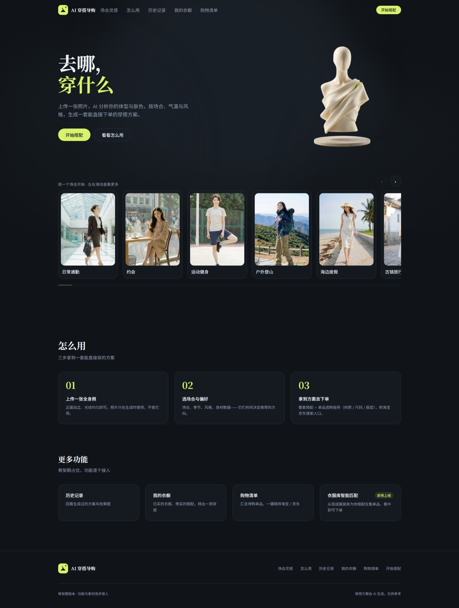

**30 秒速览**
> 🎯 **核心决策**：混合架构 — 规则保下限（确定性），AI 冲上限（创造性）
> 🛒 **完整闭环**：生成方案 → 购物清单 → 一键下单 + 效果图轻量赋能（成本可控）
> 🧪 **科学验证**：3 个实验否决了无效方案，627 条自动化断言 + 变异测试兜底
> ⚡ **Vibe Coding**：一人全栈从 0 到 1，边学边做、实验驱动持续迭代，验证节奏从月级提速到周级
> 🚧 **进行中**：智能匹配衣服库（支持上传商品库内容），已调研待做 — 解决"后期自己选衣服不快速"

**📋 导航**
- [产品全流程体验](#一产品全流程体验)
- [问题与洞察](#二问题与洞察)
- [关键产品决策](#三关键产品决策)
- [结果与数据](#四结果与数据)
- [质量工程方法：AI 不回滚靠什么](#五质量工程方法ai-不回滚靠什么)
- [反思与下一步](#六反思与下一步)

---

## 一、产品全流程体验

> 一条主线：**点场景 → 填档案 → 生成方案 → 生成效果图 → 生成购物指南(可选) → 满意存心愿单**。衣橱是**扩展功能**、不在生成主线上（衣橱里是已购买的衣服）。

### 核心生成流程

#### ① 点进场景卡片

6 个高频场景，点一下进入对应搭配模式。

---

#### ② 填档案 + 配场景气温

填写/读取身高、体型、肤色、场景、气温、风格等档案（同步生成方案页顶部档案卡）：

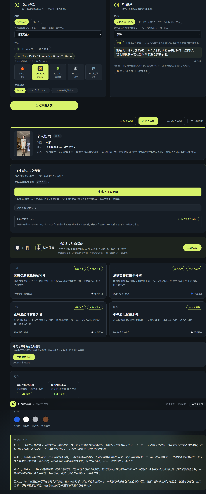

---

#### ③ 生成穿搭方案

AI 分析照片与款式 → 实时进度等待 → 输出完整方案：

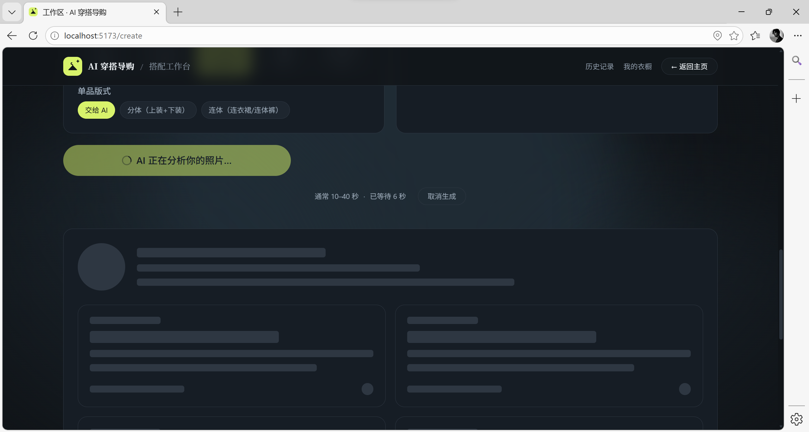
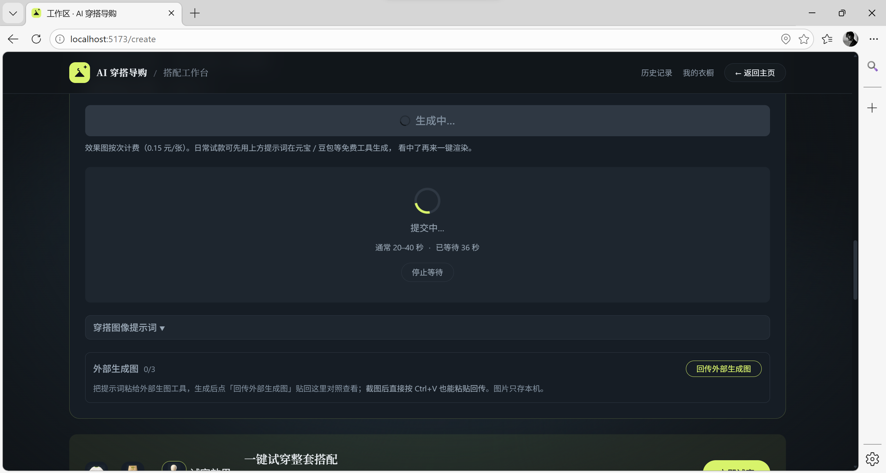

---

#### ④ 生成穿搭效果图

首次点击生成上身效果图（可选渲染），也可先交给元宝/豆包免费生成、回传对照：

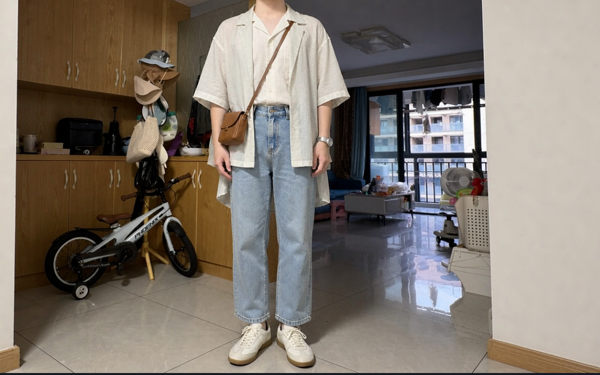
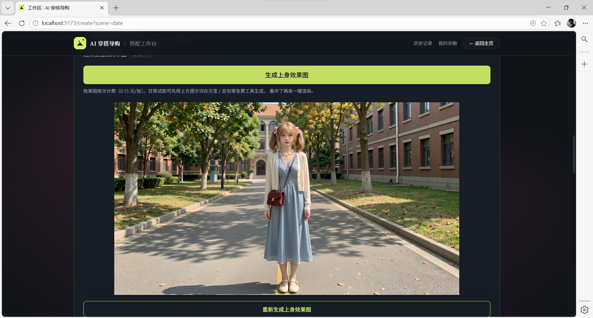
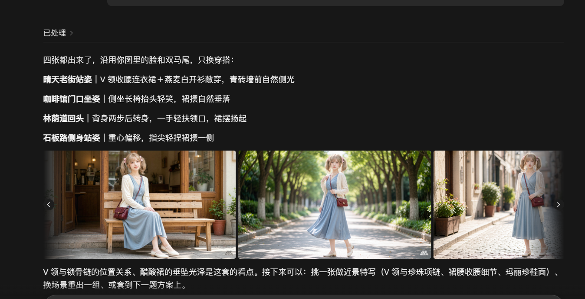

平台会把穿搭细节整理成可复制的提示词，粘到元宝/豆包即可免费出图，满意后回传对照：

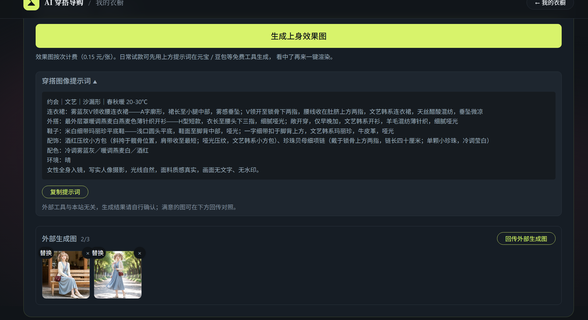

---

#### ⑤ 生成购物指南（可选）

满意后再点，每件附跳转链接与导购关键词：

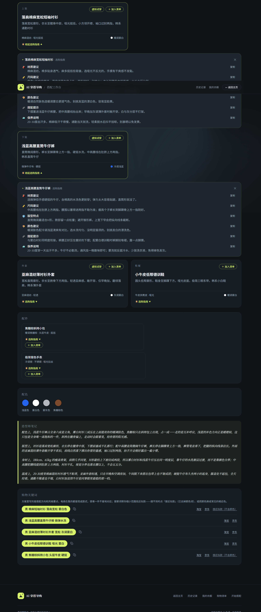
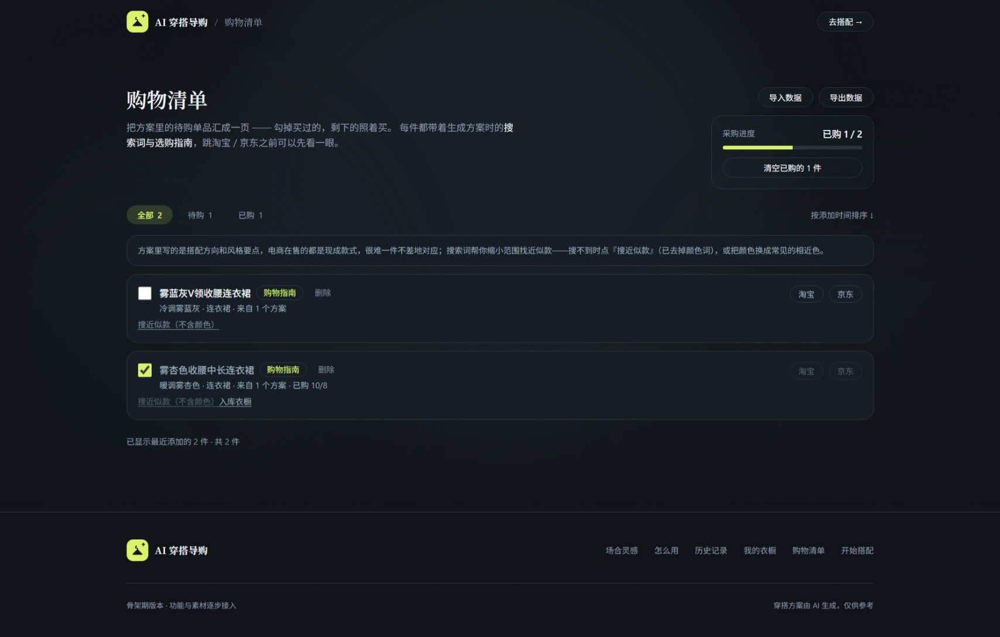

换场景可继续生成更多方案：

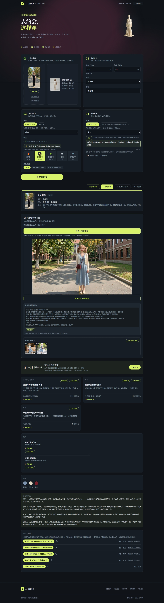

---

#### ⑥ 满意 → 存入「待买·心愿单」

把较满意方案存为"想买"，买到后移入衣橱：

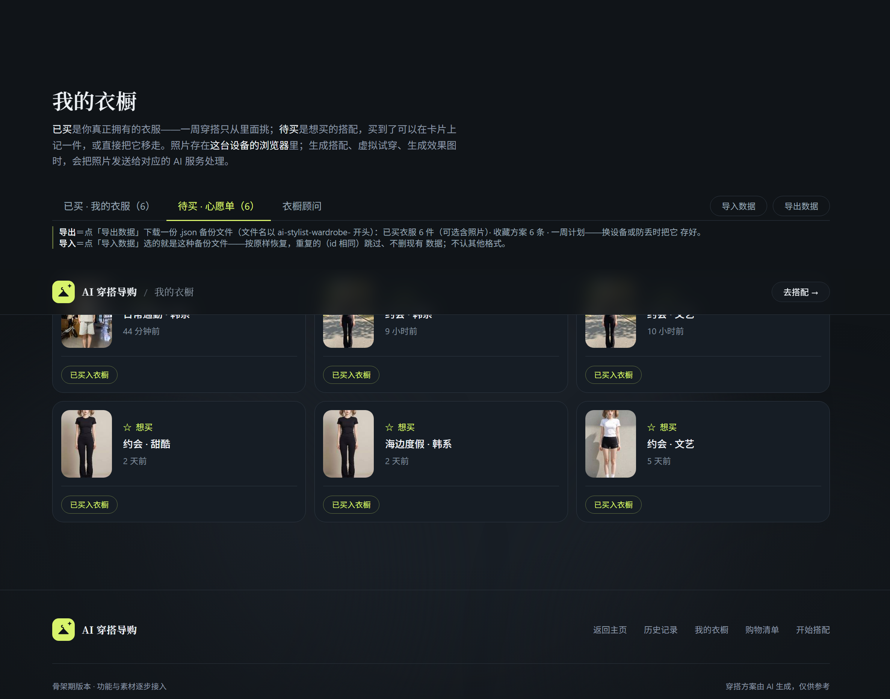

---

### 扩展功能：衣橱（不在生成流程内）

> 衣橱里是**已购买**的衣服；心愿单里的"想买"买到后移入衣橱。衣橱顾问基于已有衣物二次搭配：

**衣橱管理（已买 / 待买双轨 + AI 识图录入）**

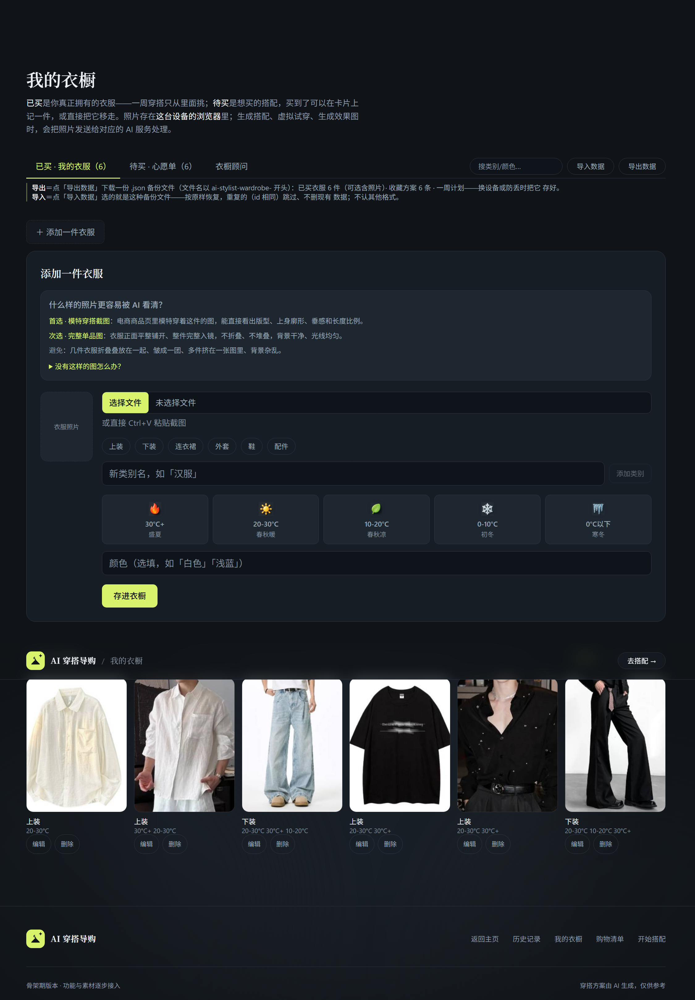

**衣橱顾问 · 一周不重样**

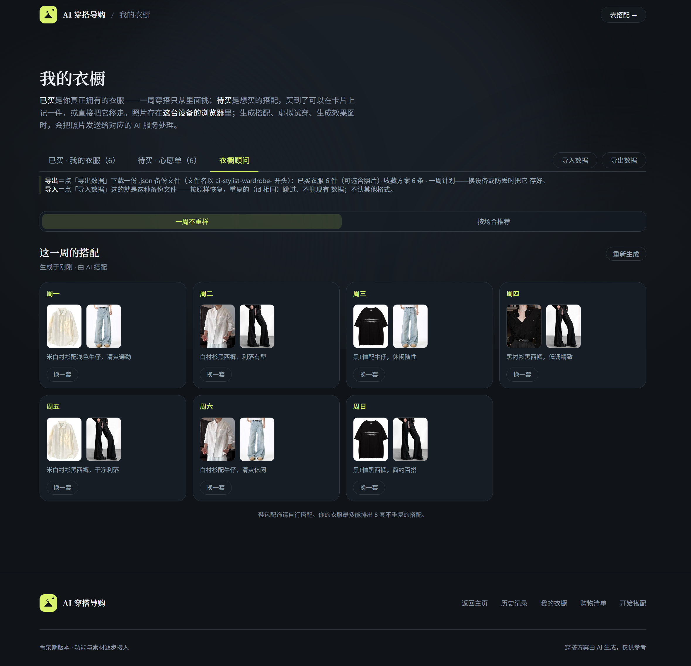

**衣橱顾问 · 按场合推荐**

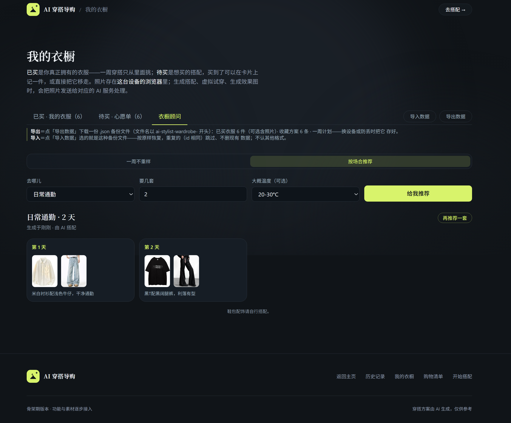

---

## 二、问题与洞察

用户网购最大的痛点是**"看不到上身效果不敢买"**。AI 穿搭 + 试穿正是解法。

**行业验证**：项目开发期间，淘宝正式上线虚拟试穿功能，验证了方向是行业共识。

我选择不同于大厂的路线：
- **大厂**：平台全包，体验最好但成本最高
- **我**：轻量赋能，先做透搭配质量，图片生成交给用户自助以控成本

> 从 0 到 1 阶段，先做透核心价值，再加强展示层，是更务实的路径。

---

## 三、关键产品决策

**不是做了什么，而是为什么这么做。** 以下决策都来自实测数据与明确选型。

### 决策 ① 混合架构 — 一半规则，一半 AI

▸ 穿搭既要"懂"（颜色/体型/场合是确定性规则），又要"审美"（风格建议是创造性表达）。

| 方案 | 问题 |
|------|------|
| **全 AI 生成** | 确定性的事容易错、会幻觉、又慢又贵 |
| **混合架构 ✓** | 规则管确定性（质量保底、成本≈0），AI 管创造性（上限更高） |

**事后校验路线**：LLM 生成 → 确定性规则检查 → 不合格打回。

### 决策 ② 用量感替代年龄 — 隐私与可信推荐

▸ 穿搭要知道"成熟度"，但直接问年龄太冒犯、也不准。

- 用**身高派生出量感三档**（小/中/大），不收取敏感信息
- 体重不参与（避免身材焦虑）
- 量感**只做软消费**（排序加权），不做硬门槛
- 依据 ACM 可信推荐研究：勿让用户因敏感特征被"不公平对待"

### 决策 ③ 分层生成 — 不一口气给完

▸ 一次生成完整方案要 60s+，用户等得焦虑。

- 首调：快出核心方案（3967→3093 token，耗时 **22.08s→15.73s，-29%**）
- 二调：按需补充选购指南等细节
- 用户全程有掌控感，也符合 IKEA Effect

### 决策 ④ 试穿选型 — 商业 API 而非自建开源

| 维度 | 自建 (IDM-VTON) | 商业 API ✓ |
|------|:---:|:---:|
| 成本 | $209–2952/月 GPU | ≈0.15 元/张，按量 |
| 周期 | 2–4 周 | 1–2 天 |
| 许可证 | ⚠️ 非商用 | ✅ 商业授权 |

> 技术选型不是选"最好的"，是选"当前阶段最合适的"。

---

## 四、结果与数据

| 指标 | 数值 |
|------|------|
| Git 提交数 | 487 次 |
| 功能模块 | 8 个 |
| 自动化断言 | 627 条（E2E+集成+单元） |
| 竞品分析 | 13 份 |
| 单次生成成本 | ≈ 0.011 元 |
| 首调耗时 | ≈ 15.7 s（优化后） |
| 规则层合规分 | 0.925（基线） |

**三层质量门禁**：黄金集回归（34 例）+ 自动化断言（627 条）+ 变异测试（60+ 场景），每次改动必跑全量。

---

## 五、质量工程方法：AI 不回滚靠什么

> AI 生成的内容是概率性的，标准答案写不死，传统断言很难直接套用。这个项目把客服评测项目沉淀的方法迁移过来，回答"怎么保证持续加功能而体验不回滚"。

- **黄金集回归（34 例）**：历史上出过问题的场景全部沉淀为固定用例，每次改动重跑——防止同一个错犯第二次
- **627 条自动化断言（单元 + 集成 + E2E）**：分层覆盖，出问题能快速定位到具体层级
- **变异测试（60+ 故障注入）**：故意制造错误，验证"断言该红的会红"——证明测试本身有效，而不是摆设
- **对照评测 + 盲评**：每次改生成 Prompt，新旧两版在同一批输入上的输出隐去版本标识后盲评，避免"新版一定更好"的心理暗示
- **自我质疑式迭代**：设计综合复盘时刻意拿数据重验 v2 的核心结论，3 个结论推翻了 2.5 个——最关键的一个否定了"输入侧要建服装词表"，避免把整个开发优先级排反
- **分层门禁**：日常快检 → 合并前回归 → 发布前全量，问题在最便宜的阶段被拦住

---

## 六、反思与下一步

**怎么做出来的**：作为产品负责人，通过 Vibe Coding（多角色 AI 助手协作）独立完成全栈 — React 19 + TS + Tailwind v4 / FastAPI + Pydantic v2 / **deepseek-flash 多模态模型**（图像分析体型肤色）+ **Vosk 语音引擎** / 自动化 + 变异测试。

**Roadmap（v2）**：
- **P0**：衣橱智能匹配 / 一周穿搭计划（按天气排班）
- **P0 · 已调研待做**：智能匹配衣服库 — 支持上传商品库内容，自动匹配推荐选衣
- **P1**：语音交互优化 / 社区灵感广场（UGC）
- **P2**：3D 虚拟形象 / 电商联盟变现

**正在寻找大模型评测工程师 / AI 评测工程师方向的岗位，欢迎联系：168314684@qq.com。**
